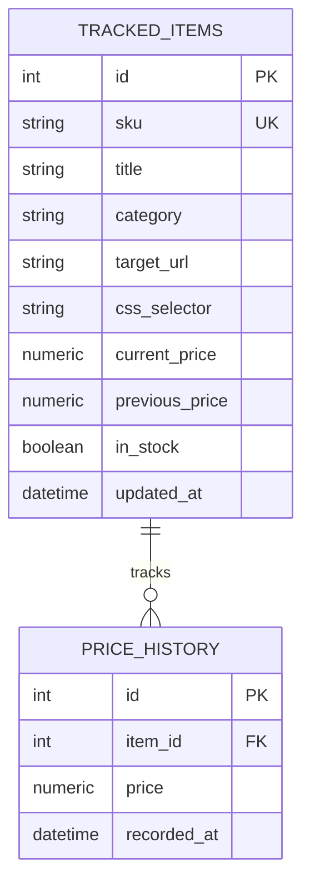

# PricePulse — Competitor Price Monitoring & Analytics

Асинхронный сервис для мониторинга цен конкурентов, трекинга прайс-индексов и товарной аналитики в e-commerce. Решение совмещает сбор данных по расписанию, кэширование аналитических выборок в Redis и веб-интерфейс с интерактивной визуализацией истории цен.

## 🚀 Ключевые возможности

* **Асинхронный сбор данных:** Неблокирующий парсинг цен и статуса наличия товаров (`httpx` + `BeautifulSoup4`/`lxml`) с обработкой сетевых таймаутов и эмуляцией заголовков браузера.
* **Двухуровневое кэширование:** Аналитические метрики (каталог, средняя цена, маркеры демпинга) кэшируются в **Redis** со стратегией инвалидации при поступлении новых замеров.
* **Аналитический дашборд:** Интерактивная витрина на **TailwindCSS** + **Chart.js** с динамическим графиком изменения цен по каждому SKU.
* **REST API и экспорт:** Документированные эндпоинты (FastAPI / OpenAPI) и выгрузка отчетов в CSV (Excel-ready с кодировкой UTF-8 BOM).

## 🛠 Технологический стек

* **Бэкенд:** Python 3.12, FastAPI, Uvicorn, Pydantic v2
* **База данных:** PostgreSQL 16, SQLAlchemy 2.0 (asyncpg)
* **Кэш:** Redis 7
* **Сбор данных:** HTTPX (async client), BeautifulSoup4, lxml
* **Инфраструктура:** Docker, Docker Compose
* **Тестирование:** pytest, pytest-asyncio

## 🗄 Схема данных (ER-диаграмма)



## ⚙️ Быстрый запуск

1. Склонируйте репозиторий и создайте конфигурационный файл:
   ```bash
   cp .env.example .env
   ```
2. Запустите инфраструктуру через Docker Compose:
   ```bash
   docker compose up -d --build
   ```
3. Сервис автоматически применит схему БД и наполнит каталог демонстрационными товарами:
   * **Веб-дашборд:** [http://localhost:8088](http://localhost:8088)
   * **Swagger API Docs:** [http://localhost:8088/docs](http://localhost:8088/docs)

## 🧪 Запуск тестов

```bash
pytest -v tests/
```
